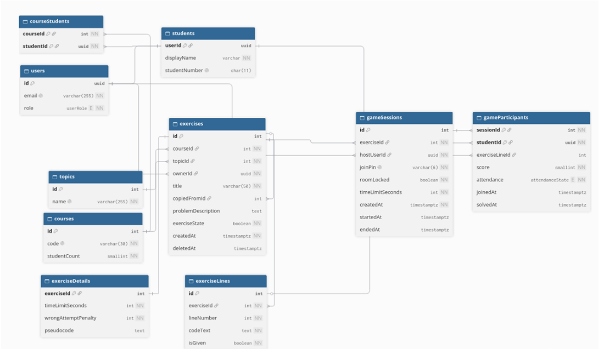
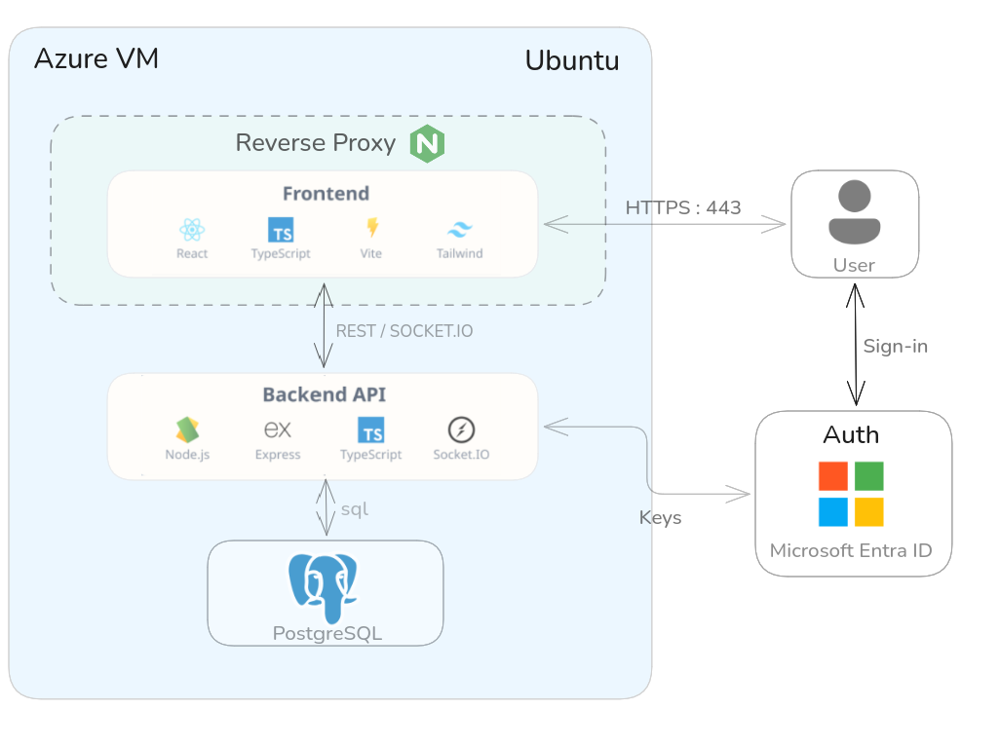

# CodeLine

Classroom code-line exercises and live games, using university Microsoft sign-in.

## Run locally

Requires Node.js >=22.12 and npm. The existing PostgreSQL schema is already
migrated; the application never installs or migrates it on startup.

```bash
npm ci
# Fill backend/.env using backend/.env.example; keep real credentials private.
npm run dev
```

Open [CodeLine](http://localhost:5173/). Vite proxies the API and Socket.IO to
Express on `127.0.0.1:3001`. Private PostgREST uses port 3000 separately.

## Implemented

- Microsoft Entra/MSAL sign-in and database-backed admin, lecturer, TA, student roles.
- Admin accounts, student profiles, course CRUD and student enrollment.
- Figma-style exercise library, new-exercise dialog, line editor, text/code import,
  copies, drafts/ready validation, archive and undo. Played exercises stay immutable.
- Lobby PIN/QR, roster snapshot, room lock and attendance correction.
- Authorized Socket.IO updates, a waiting-room playground with movement/colors/emotes,
  unique student line assignments, attempts and deadline enforcement.
- Server-side scores from 100 down to 0; unsolved/absent final scores are 0.
- Rejoining, results, game history, course totals, CSV and temporary activity logs.
- Local-only admin role testing, with an explicit real-account enrollment control.

No submitted code is executed. Students place their assigned code at a position.
Game answers are hidden until given, solved, revealed for absence or game end.
The game needs exactly one BLANK line for each enrolled student; GIVEN lines are extra.
The manually planned course count is a guide; the actual enrolled roster determines
lobby assignments. New users must sign in once before an admin can enroll them.

## Verify

```bash
npm run typecheck -w backend
npm run typecheck -w frontend
npm test                       # DB integrations are skipped unless enabled
TEST_DATABASE=1 npm test        # includes real PostgreSQL integration fixtures
npm run build
```

Integration fixtures roll back. PostgreSQL identity sequences can still advance.
The shared-IP test checks request limiting for 61 simulated identities, not a
60-player performance/load guarantee. Rehearse with the actual class before use.

## Data retention

PostgreSQL persists courses, exercises, session rosters, assignments and scores.
Waiting-room positions/emotes and detailed activity are memory-only; export activity
before restarting if you need a copy. Wrong-attempt request IDs are deduplicated in
memory for ten minutes and are not a durable per-attempt audit log.

The design's semester/section tabs and permanent detailed history are represented
by course totals and an explicitly temporary activity log, matching the agreed
simplified schema. No extra tables were introduced.

## Deployment

Deployment files are prepared in [deployment](deployment/DEPLOYMENT.txt), including
Nginx, systemd, an environment template and a release packager. Application files
and the API are installed on the Azure VM. Public HTTPS is verified at
[CodeLine demo](https://codeline-demo-g06.eastasia.cloudapp.azure.com), and its Entra
Web callback is saved. **Microsoft sign-in still needs a replacement private client
secret and end-to-end verification.** The previous secret was shared in chat.
The existing self-signed PostgreSQL setup uses TLS encryption without server
certificate verification; configure a trusted CA before switching to verify-full.

```bash
./deployment/package-release.sh
```

See [development notes](docs/development.txt) for project history. The stack is React,
TypeScript, Vite, Tailwind, Node/Express, Socket.IO and PostgreSQL 16. Environment
files, private keys, sessions and real student data must not be committed.

## Database ERD



[Open the full-size ERD](docs/diagrams/codeline-erd.png). The existing PostgreSQL
schema uses quoted camelCase identifiers; preserve it when configuring the app.

## System architecture



[Open the full-size architecture](docs/diagrams/codeline-system-architecture.png).
The target demo hosts Nginx, the frontend, the Express/Socket.IO API and PostgreSQL
on one Azure Ubuntu VM, with Microsoft Entra ID for sign-in. The VM API uses
loopback port 3002 because existing PostgREST occupies 3000 and 3001. Verify real
Microsoft sign-in and rehearse the classroom flow before a live demonstration.

## Development credit

The application implementation was coded by **OpenAI Codex**, under the CodeLine
team's direction. The team supplied the project requirements, stakeholder notes,
Figma designs and system models.
